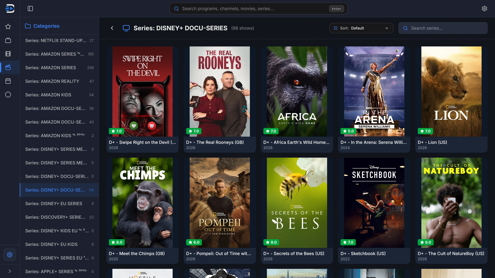
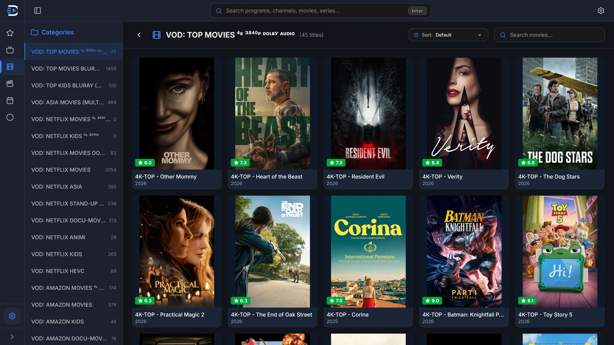
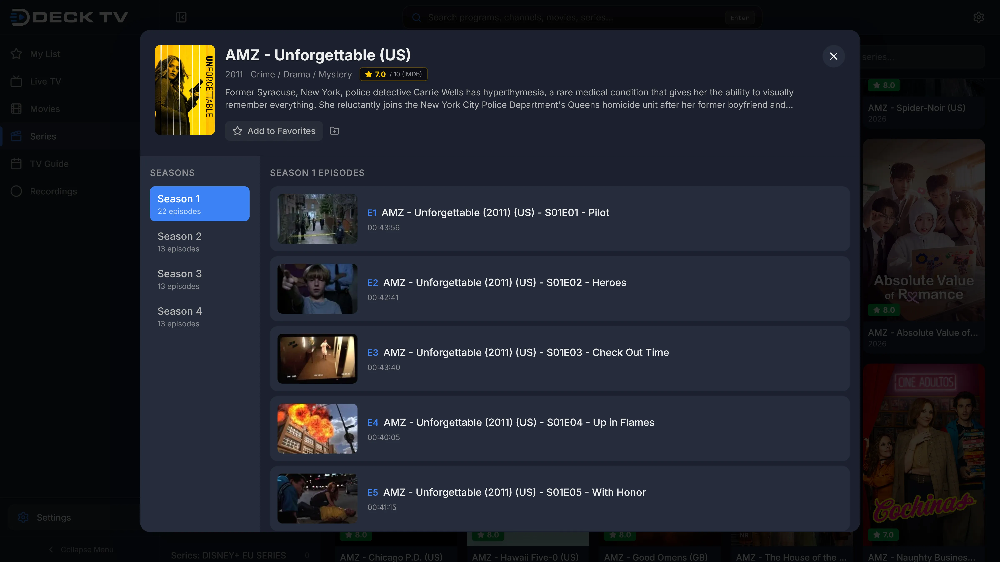
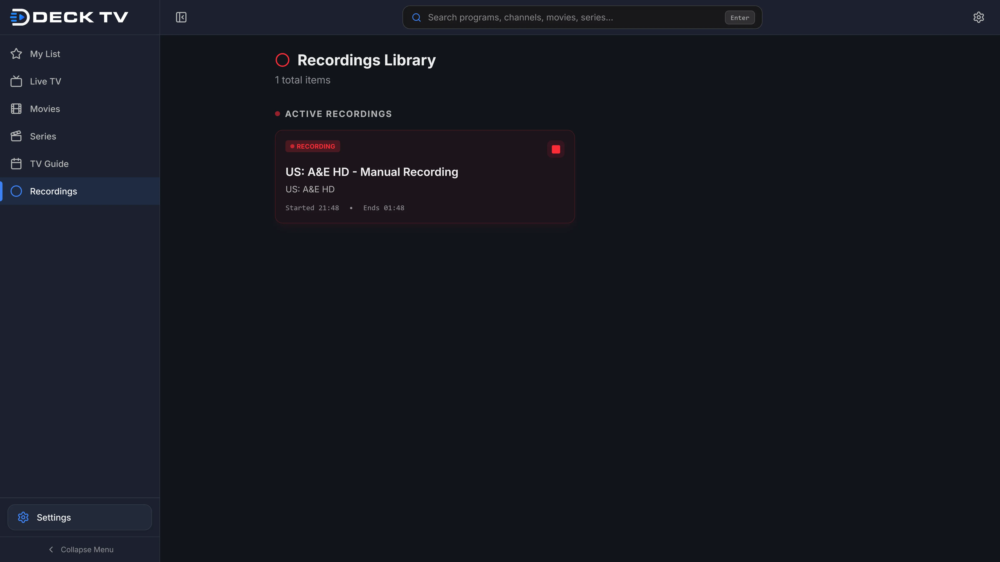
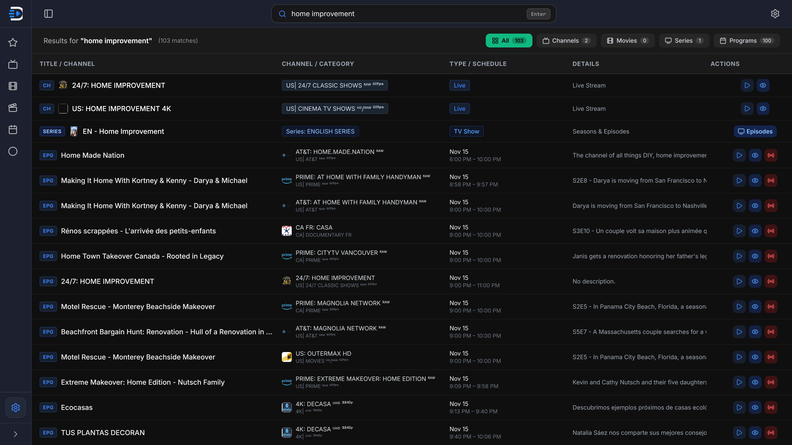
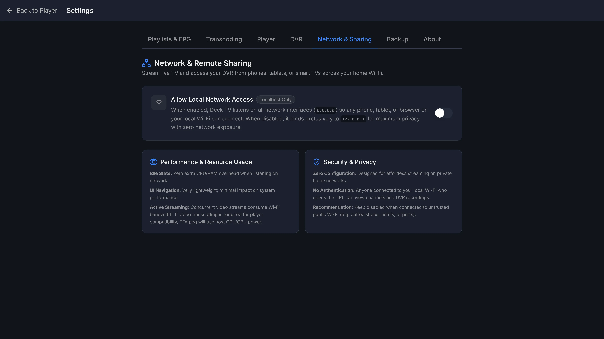

<p align="center">
  
</p>

# Deck TV

[](https://github.com/mwongr/deck-tv)
[](https://nextjs.org/)
[](https://react.dev/)
[](https://tailwindcss.com/)
[](https://github.com/WiseLibs/better-sqlite3)
[](#license)

**Deck TV** is a high-performance IPTV player, centralized media server, and autonomous background DVR system built for the modern cord-cutter. Bridging the gap between lightweight streaming clients and resource-heavy media servers, Deck TV operates as a self-hosted web application and continuous background service. Deck TV schedules and records live broadcasts autonomously, transcodes incompatible feeds on the fly using dedicated GPU acceleration, normalizes multi-channel surround audio for clear dialogue, and shares your entire library across any device on your local network.

---

## Table of Contents

- [Screenshots](#screenshots)
- [Key Features](#key-features)
  - [Local Network Streaming & Web Server](#local-network-streaming--web-server)
  - [Live TV & Electronic Program Guide (EPG)](#live-tv--electronic-program-guide-epg)
  - [Autonomous Background DVR Engine](#autonomous-background-dvr-engine)
  - [My List & Custom Content Groups](#my-list--custom-content-groups)
  - [VOD Library: Movies & TV Series](#vod-library-movies--tv-series)
  - [Real-Time Hardware Transcoding & Audio Downmixing](#real-time-hardware-transcoding--audio-downmixing)
  - [Smart Playback Engine & Per-Channel Memory](#smart-playback-engine--per-channel-memory)
- [Detailed Settings Guide](#detailed-settings-guide)
  - [1. Playlists Management](#1-playlists-management)
  - [2. Electronic Program Guide (EPG)](#2-electronic-program-guide-epg)
  - [3. Stream Optimization & Transcoding](#3-stream-optimization--transcoding)
  - [4. Player Configuration](#4-player-configuration)
  - [5. DVR Configuration](#5-dvr-configuration)
  - [6. Network & Sharing](#6-network--sharing)
  - [7. Backup & Restore](#7-backup--restore)
- [Getting Started](#getting-started)
  - [Prerequisites](#prerequisites)
  - [Installation & Quick Start](#installation--quick-start)
  - [Running on Windows (`start-deck-tv.bat`)](#running-on-windows-start-deck-tvbat)
- [Technology Stack](#technology-stack)
- [Disclaimer](#disclaimer)
- [License](#license)

---

## Screenshots

<table>
  <tr>
    <td align="center" width="50%">
      <br />
      <sub><b>Live TV</b></sub>
    </td>
    <td align="center" width="50%">
      <br />
      <sub><b>Series</b></sub>
    </td>
  </tr>
</table>

<table>
  <tr>
    <td align="center" width="33%">
      <br />
      <sub><b>TV Guide</b></sub>
    </td>
    <td align="center" width="33%">
      <br />
      <sub><b>Movies</b></sub>
    </td>
    <td align="center" width="33%">
      <br />
      <sub><b>Movies Watch</b></sub>
    </td>
  </tr>
  <tr>
    <td align="center" width="33%">
      <br />
      <sub><b>Episodes</b></sub>
    </td>
    <td align="center" width="33%">
      <br />
      <sub><b>Favourites and Groups</b></sub>
    </td>
    <td align="center" width="33%">
      <br />
      <sub><b>Custom Groups</b></sub>
    </td>
  </tr>
  <tr>
    <td align="center" width="33%">
      <br />
      <sub><b>Recording</b></sub>
    </td>
    <td align="center" width="33%">
      <br />
      <sub><b>Search</b></sub>
    </td>
    <td align="center" width="33%">
      <br />
      <sub><b>Settings</b></sub>
    </td>
  </tr>
</table>

---

## Key Features

### Local Network Streaming & Web Server
- **Self-Hosted Web App**: Run Deck TV locally or on a dedicated home server and stream from any modern browser with hardware-accelerated decoding.
- **Network & LAN Sharing**: Stream directly to any device on your local Wi-Fi or home network. Toggle remote connections with a single click and access Deck TV instantly from your smartphone, tablet, laptop, or Smart TV browser.
- **Automatic IP Detection**: Displays local network access addresses (`http://<ip>:38472`) with quick-copy shortcuts and multi-interface recognition.

### Live TV & Electronic Program Guide (EPG)
- **Interactive 24-Hour Timeline Guide**: Smooth horizontal and vertical scrolling with real-time program progress bars, start/end indicators, program summaries, and schedule metadata.
- **Multi-Source EPG Aggregation**: Combine multiple XMLTV URL feeds (including compressed `.xml.gz` files) and automatically associate them with channels by `tvg-id`, `tvg-name`, or normalized name matching.
- **High-Performance Virtualized Channel List**: Effortlessly scrolls through playlists with tens of thousands of channels at a locked 60 FPS without UI freezing or memory bloat.
- **Catchup & Timeshift Integration**: Access historical broadcast archives for supported channels directly from the guide interface.
- **One-Click Instant Recording**: Trigger immediate recordings of the currently playing show or schedule upcoming broadcasts right from the EPG card.

### Autonomous Background DVR Engine
- **Independent Server Scheduler**: Scheduled captures trigger and execute via an autonomous server process—recordings continue reliably even if all browser tabs and client windows are closed.
- **FFmpeg Watchdog Auto-Recovery**: If a stream drops or encounters network jitter, the watchdog automatically recovers, reconnects with exponential backoff, and appends incoming footage seamlessly.
- **Interactive Storage Directory Picker**: Select any local drive or mounted NAS folder for capture files using the built-in system directory browser.
- **Stream Conflict Protection**: Prioritizes active recordings over interactive viewing to keep single-connection IPTV accounts safely within their provider stream quotas.
- **External Player Integration**: Open completed or in-progress DVR files directly in your favorite desktop player (VLC, MPC-HC, MPV, PotPlayer).

### My List & Custom Content Groups
- **Curated Single-Content Groups**: Create dedicated custom groups specifically for Live TV, Movies, or TV Series to keep your library clean and organized.
- **Drag-and-Drop Reordering**: Intuitively drag and rearrange the exact playback sequence of your favorite channels and custom group items.
- **Unified Global Search**: Search instantly across all channel names, group categories, VOD movies, TV shows, and EPG listings with immediate preview results.
- **Quick-Action Modals**: Add or remove channels, movies, and series to any custom group on the fly with responsive popover selectors.

### VOD Library: Movies & TV Series
- **Dedicated Media Explorers**: Browse rich catalogs for on-demand Movies and TV Series with cover artwork, plot descriptions, genre tags, and release dates.
- **Episodic Series Viewer**: Intuitively organized season and episode listings with runtime counters and individual episode overviews.
- **Multi-Stream Audio & Subtitle Switching**: Switch alternate audio tracks and subtitle streams seamlessly during playback on supported feeds.

### Real-Time Hardware Transcoding & Audio Downmixing
- **Broad GPU Acceleration**: Leverages NVIDIA NVENC, AMD Radeon AMF, Intel QuickSync (QSV), or Linux VAAPI for lightning-fast, low-CPU re-encoding.
- **Intelligent Transcoding Passthrough**: Streams that are natively supported by the player pass through without re-encoding, preserving pristine quality and using zero encoding overhead.
- **ITU BS.775 Surround Sound Downmixing**: Cleanly converts 5.1 and 7.1 multi-channel audio feeds (AC3, E-AC3, AAC, DTS) into stereo, preventing quiet dialogue and loud sound effects.
- **Specialized Audio Modes**: Choose from Adaptive Stereo, Standard Balanced, Clear Dialogue / Night Mode, Expanded Soundstage, or Raw Passthrough.

### Smart Playback Engine & Per-Channel Memory
- **Per-Channel Parameter Memory**: Deck TV automatically remembers audio track selections, audio downmixing presets, and transcoding settings on a per-channel basis.
- **Web Worker Offloading**: Demuxing, transmuxing, and buffering are handled on a dedicated background worker thread, ensuring UI interactions never cause frame drops.
- **Auto-Hiding Controls & Fullscreen Cursor**: Cinematic playback with automatically fading on-screen controls and cursor hiding during fullscreen viewing.

---

## Detailed Settings Guide

Deck TV includes an extensive, modular **Settings** panel accessible via the gear icon in the navigation bar or by visiting `/settings`. Each tab controls a specific subsystem of the platform:

### 1. Playlists Management
Manage the IPTV providers that feed channels, video-on-demand movies, and TV series into Deck TV.

* **Supported Formats**:
  * **M3U / M3U8 URLs**: Web-hosted playlist feeds that automatically synchronize on a schedule.
  * **Xtream Codes API**: Full integration with Xtream-compatible services. Input your **Server URL**, **Username**, and **Password** to automatically import live channels, categories, movie catalogs, series libraries, and associated XMLTV endpoints.
  * **Local M3U File Uploads**: Upload offline playlist files stored on your local disk.
* **Provider Operations**:
  * **Sync Now**: Manually trigger an immediate update of channels, groups, and stream URLs.
  * **Enable / Disable**: Temporarily hide all channels from a specific provider without deleting its configuration.
  * **Channel & Group Metrics**: View real-time counts for active channels and detected categories.
  * **Delete**: Remove a provider and clean up its associated channel records from the database.

---

### 2. Electronic Program Guide (EPG)
Configure XMLTV sources to power the interactive TV guide timeline and program schedules.

* **EPG Source Configuration**:
  * **XMLTV URL**: Input direct HTTP/HTTPS URLs to `.xml` or compressed `.xml.gz` program guide files.
  * **Refresh Interval**: Set automated guide download schedules (e.g., every 12, 24, or 48 hours).
* **Guide Synchronization**:
  * **Refresh EPG**: Force an immediate download and parsing pass of guide listings.
  * **Program Metrics**: Displays the total count of parsed programs and timestamp of the last successful sync pass.
  * **Smart Channel Matching**: Automatically associates program events with channels using `tvg-id`, `tvg-name`, or normalized channel title matching.

---

### 3. Stream Optimization & Transcoding
Configure the real-time media encoding engine, GPU acceleration, resolution limits, and audio acoustic processing.

#### GPU & Hardware Acceleration
* **Acceleration Engine**:
  * **Auto (Recommended)**: Automatically probes the host machine and selects the primary GPU encoder.
  * **NVIDIA NVENC**: Uses dedicated hardware NVENC encoders on NVIDIA GeForce / Quadro / Tesla GPUs for ultra-low latency.
  * **AMD Radeon (AMF)**: Hardware encoding using AMD Advanced Media Framework.
  * **Intel QuickSync (QSV)**: Utilizes Intel integrated graphics (iGPU) or Intel Arc discrete graphics.
  * **VAAPI (Linux)**: Video Acceleration API for Linux servers and NAS appliances.
  * **CPU Only (Software)**: Traditional CPU encoding fallback (libx264) for systems without dedicated graphics.

#### Stream Boundaries & Encoding Profiles
* **Resolution Ceiling**: Set maximum bounds when re-encoding is active to prevent bandwidth choking:
  * `Original / 4K Ultra HD` | `1080p Full HD` | `720p Standard HD` | `480p Standard Definition`
* **Encoding Profile / Quality Preset**:
  * **High Fidelity**: Higher bitrate for maximum visual clarity on high-resolution displays.
  * **Balanced (Default)**: Optimized trade-off between visual quality and encoding efficiency.
  * **High Performance**: Low-bitrate, rapid encoding optimized for slower remote networks or low-power hosts.

#### Surround Sound Mode & Audio Downmixing
IPTV feeds often stream multi-channel (5.1 / 7.1) audio tracks (AC3, E-AC3, AAC, DTS) that sound muffled or have buried dialogue on standard stereo television speakers or laptops. Deck TV includes specialized audio filters:

| Audio Profile | Acoustic Behavior | Best Used For |
| :--- | :--- | :--- |
| **Adaptive Stereo** *(Default)* | Leaves stereo audio unaltered; blends multi-channel surround into clean 2.0 sound. | General daily viewing, news, sports. |
| **Standard Balanced** | Conforms strictly to ITU BS.775 reference downmixing coefficients. | Studio-accurate speaker & headphone listening. |
| **Clear Dialogue / Night Mode** | Compresses dynamic range; amplifies voice frequencies while dampening loud explosions. | Late-night watching without volume spiking. |
| **Expanded Soundstage** | Widens spatial acoustic dynamics and enhances channel separation. | Action movies, theater speakers, cinematic content. |
| **Raw Passthrough** | Bypasses all downmixing filters and passes the untouched digital stream. | Sending raw audio to an external AV Receiver / Soundbar. |

#### Stream Compatibility Processing
* **Intelligent Transcoding**: When active, incoming streams that your browser decodes natively (H.264 video with AAC/MP3 audio) pass through without encoding. Only incompatible codecs (HEVC, MPEG2VIDEO, AC3, DTS) trigger conversion.
* **Force Audio Transcode**: Re-encodes multi-channel or unsupported audio formats to stereo AAC while leaving video untouched (zero video CPU load).
* **Direct Stream Remuxing**: Repackages MPEG-TS transport streams into standard HLS (`m3u8`) manifests without re-compressing the video.
* **Backend Stream Proxy**: Routes traffic through Deck TV's local backend proxy to resolve CORS restrictions, SSL certificate mismatches, or ISP protocol blocking.
* **Per-Channel Override Reset**: Easily view and clear individual custom stream overrides directly from the transcoding panel.

---

### 4. Player Configuration
Fine-tune client-side playback behavior, hardware utilization, and external software integration.

* **Hardware Acceleration (HLS Web Worker)**:
  * Offloads demuxing, transmuxing, and buffer memory allocation to a dedicated Web Worker thread.
  * Ensures UI interactions (opening menus, searching, scrolling) never cause video frame drops.
* **Playback Engine Selection**:
  * **Browser Built-In**: High-performance HLS.js player rendered directly inside the web interface with full on-screen controls, guide overlays, and audio track selectors.
  * **External Media Player**: Launch live streams or DVR files in desktop applications such as **VLC Media Player**, **MPC-HC**, **MPV**, or **PotPlayer**.

---

### 5. DVR Configuration
Control recording destinations, storage policies, and capture watchdog parameters.

* **Recording Storage Directory**:
  * Displays the active filesystem path where all recorded `.ts` files and metadata are stored.
  * Includes the interactive **Folder Picker** modal to browse local drives (C:, D:, etc.) or mounted network shares without manually typing paths.
  * Defaults to `./recordings` in the project root if unconfigured.
* **Conflict Prevention & Single-Connection Protection**:
  * Protects accounts with strict connection limits (e.g., 1-stream subscriptions) by prioritizing scheduled captures over interactive viewing.
* **Automatic File Organization**:
  * Recordings are named systematically (`ChannelName_ProgramTitle_YYYY-MM-DD_HH-mm.ts`) with corresponding JSON metadata files for easy indexing.

---

### 6. Network & Sharing
Manage local network distribution and access Deck TV across your entire household.

* **Remote Access Toggle**: Enable listening across all network interfaces (`0.0.0.0`) or restrict Deck TV to the local host machine (`127.0.0.1`).
* **LAN URL Discovery**: Automatically detects your host machine's local IP address and provides ready-to-use access URLs (e.g. `http://192.168.1.100:38472`) for phones, tablets, and Smart TVs.
* **Multi-Interface Viewer**: Inspect all available network adapters (Wi-Fi, Ethernet, virtual bridges) and their assigned IP addresses.
* **One-Click Relaunch**: Apply network configuration updates with seamless server relaunching directly from the settings view.

---

### 7. Backup & Restore
Safeguard your entire IPTV environment, migrate to a new machine, or roll back configuration changes.

* **Comprehensive Backup Scope**:
  Deck TV exports a clean, portable `JSON` file containing:
  * All playlist source definitions (M3U & Xtream Codes credentials).
  * XMLTV EPG source endpoints and refresh schedules.
  * System channels, categorized groups, and favorites.
  * **Custom Groups & Member Items**: All custom-created groups across Live TV, Movies, and Series along with exact custom sort sequences.
  * **Stream Transcoding Profiles**: Hardware encoder preferences, resolution limits, and audio mixing presets.
  * **Player Settings & Dexie Cache**: Web worker flags, external player options, and custom DVR paths.
* **Restoration Engine**:
  * Upload any previously saved Deck TV backup `.json` file to restore settings.
  * Automatically wipes and rebuilds SQLite tables with foreign key integrity.
  * Invalidates and rebuilds client IndexedDB caches, prompting a seamless auto-refresh.
  * Displays a detailed breakdown of restored entities (Playlists, Favorites, Custom Groups, Settings).

---

## Getting Started

### Prerequisites

1. **Node.js**: Version **18.17.0** or higher (Version 20+ recommended).
2. **FFmpeg**: **Required for DVR recording and transcoding**. Ensure `ffmpeg` and `ffprobe` are installed on your operating system and available in your system's `PATH`.
   * **Windows**: Download a release build from [gyan.dev](https://www.gyan.dev/ffmpeg/builds/) or install via winget:
     ```bash
     winget install Gyan.FFmpeg
     ```
   * **Linux (Ubuntu/Debian)**:
     ```bash
     sudo apt update && sudo apt install ffmpeg
     ```
   * **macOS (Homebrew)**:
     ```bash
     brew install ffmpeg
     ```

---

### Installation & Quick Start

1. **Clone the repository**:
   ```bash
   git clone https://github.com/mwongr/deck-tv.git
   ```

2. **Navigate to the project directory**:
   ```bash
   cd deck-tv
   ```

3. **Install project dependencies**:
   ```bash
   npm install
   ```

4. **Start the application**:
   ```bash
   npm run dev
   ```

5. **Access Deck TV**:
   Open [http://localhost:38472](http://localhost:38472) in your web browser.

---

### Running on Windows (`start-deck-tv.bat`)

For Windows users, Deck TV includes a convenient startup script (`start-deck-tv.bat`) that handles everything in one click:

1. Verifies `node_modules` installation (runs `npm install` automatically if needed).
2. Detects your local network IP address (e.g. `http://192.168.1.50:38472`) so you can access Deck TV from your phone, tablet, or Smart TV browser.
3. Boots the unified **Next.js Server & Built-in DVR Engine** in a single console window.

Simply double-click **`start-deck-tv.bat`** from the application folder.

---

## Technology Stack

* **Framework**: [Next.js 16](https://nextjs.org/) (App Router & API Handlers)
* **UI Library**: [React 19](https://react.dev/) & [TypeScript 5](https://www.typescriptlang.org/)
* **Styling**: [Tailwind CSS v4](https://tailwindcss.com/)
* **Server Database**: [Better-SQLite3](https://github.com/WiseLibs/better-sqlite3) (WAL mode enabled)
* **Client Database**: [Dexie.js](https://dexie.org/) (IndexedDB wrapper)
* **Video Playback Engine**: [HLS.js](https://github.com/video-dev/hls.js/) with dedicated Web Worker support
* **Media Processing**: [FFmpeg](https://ffmpeg.org/) (Recording watchdog, stream transcode, downmixing)
* **Virtualization**: [@tanstack/react-virtual](https://tanstack.com/virtual/latest)
* **Icons**: [Lucide React](https://lucide.dev/)
* **Date Utilities**: [date-fns](https://date-fns.org/)

---

## Disclaimer

Deck TV is strictly an **IPTV media player and management application**. It does **not** include, host, sell, or provide any pre-loaded channels, IPTV playlists, EPG guides, streams, or media content of any kind. Users must supply their own legally obtained playlists or Xtream Codes credentials and are solely responsible for the content they stream or record.

---

## License

This project is licensed under the **Creative Commons Attribution-NonCommercial 4.0 International (CC BY-NC 4.0)** license. See the [full license text](https://creativecommons.org/licenses/by-nc/4.0/legalcode) or the [human-readable summary](https://creativecommons.org/licenses/by-nc/4.0/) for complete details.

### What You Can Do
* **Share**: Copy and redistribute the material in any medium or format for non-commercial purposes.
* **Adapt**: Remix, transform, and build upon the material for non-commercial purposes.

### Under the Following Terms
* **Attribution**: You must give appropriate credit, provide a link to the license, and indicate if changes were made.
* **NonCommercial**: You may not use the material for commercial purposes (including paid hosting, commercial redistribution, or bundling into paid products/services) without explicit prior permission from the copyright holder.
* **No Additional Restrictions**: You may not apply legal terms or technological measures that legally restrict others from doing anything the license permits.

### Disclaimer & Third-Party Content
Deck TV is provided **"as is"**, without warranty of any kind, express or implied. Deck TV is solely a media player and management application—it does not include, host, or provide any IPTV playlists, channels, EPG feeds, or media content. Users are solely responsible for the streams they configure and must ensure compliance with all applicable laws and the terms of service of their content and IPTV providers.


---

## Desktop App (Electron)

Deck TV can also be run and packaged as a standalone Windows desktop application via Electron (`39.8.10`) and `electron-builder` (`26.18.0`).

### Run Locally in Electron

```bash
npm install
npm run start:electron
```

### Build Windows Installer & Smoke Test

```bash
npm run build:exe
npm run smoke:exe
```

`build:exe` builds the Next.js production bundle (`NEXT_PUBLIC_APP_TIER=exe`), shims Turbopack native-module links (`electron/prepare-next.js`), rebuilds `better-sqlite3` for Electron, and packages `dist-electron/Deck-TV-Setup-1.0.0.exe`. `postbuild:exe` restores `better-sqlite3` for Node.js afterward.
